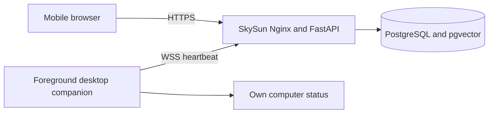

# SkySun v1.6.0

SkySun is a multi-user AI Agent workspace. It combines conversations, curated personal memory, private and shared knowledge, persistent tasks, and execution visibility in one responsive web application. DeepSeek powers reasoning; PostgreSQL and pgvector persist state and retrieve document evidence.

## Architecture

The React and TypeScript frontend calls FastAPI through same-origin `/api` routes. FastAPI authenticates bearer tokens and passes the user context into the existing Agent, memory, task, and knowledge stores. PostgreSQL holds conversations, memories, documents, tasks, and observability records; pgvector searches embedded document passages. A local multilingual E5 model creates embeddings. Existing unprefixed API routes remain available for earlier clients.



## Docker local deployment

Install Docker Engine or Docker Desktop with the Compose plugin. Copy `.env.example` to `.env`, then set a real `DEEPSEEK_API_KEY`, a random `SKYSUN_ADMIN_TOKEN` of at least 32 characters, and a random hexadecimal `POSTGRES_PASSWORD`. Keep `.env` local and use hexadecimal characters for the database password so it can be inserted safely into the PostgreSQL URL.

```bash
cp .env.example .env
# Edit .env and fill the three required values.
docker compose up --build
```

Open `http://localhost:8080` (or the port set by `SKYSUN_PORT`). The stack contains the Nginx frontend, FastAPI backend, and PostgreSQL 16 with pgvector. Compose enables the `vector` extension on first database creation and stores PostgreSQL data in a named volume. The backend image downloads the embedding model while building, so the first build requires network access and can take several minutes. The admin token provisions `legacy_admin`; use `POST /api/admin/users` with its bearer token to create ordinary users. The frontend login accepts the username and issued token.

The production Nginx container serves the web app at `/` and returns the same app entry point for direct links such as `/chat`. API requests under `/api/` continue to reach FastAPI.

For subsequent starts, use `docker compose up`; use `docker compose down` to stop the stack while preserving the database volume.

## Versions

- [v0.1.0](https://github.com/Zhantianbao/SkySun/releases/tag/v0.1.0) — Agent core, chat API, and word-count tool.
- [v0.2.0](https://github.com/Zhantianbao/SkySun/releases/tag/v0.2.0) — Conversation history within a running process.
- [v0.3.0](https://github.com/Zhantianbao/SkySun/releases/tag/v0.3.0) — PostgreSQL-backed conversation persistence.
- [v0.4.0](https://github.com/Zhantianbao/SkySun/releases/tag/v0.4.0) — Durable personal memory and memory tools.
- [v0.5.0](https://github.com/Zhantianbao/SkySun/releases/tag/v0.5.0) — Automatic memory curation.
- [v0.6.0](https://github.com/Zhantianbao/SkySun/releases/tag/v0.6.0) — Persistent document knowledge and vector RAG.
- [v0.7.0](https://github.com/Zhantianbao/SkySun/releases/tag/v0.7.0) — Grounded Knowledge Reasoning.
- [v0.8.0](https://github.com/Zhantianbao/SkySun/releases/tag/v0.8.0) — Agent Memory & Tool Reliability.
- [v0.9.0](https://github.com/Zhantianbao/SkySun/releases/tag/v0.9.0) — Agent Workflow & Task Planning.
- [v1.0.0](https://github.com/Zhantianbao/SkySun/releases/tag/v1.0.0) — Persistent Agent Runtime.
- [v1.1.0](https://github.com/Zhantianbao/SkySun/releases/tag/v1.1.0) — Multi-User Agent Platform.
- [v1.2.0](https://github.com/Zhantianbao/SkySun/releases/tag/v1.2.0) — Agent Observability & Evaluation System.
- [v1.3.0](https://github.com/Zhantianbao/SkySun/releases/tag/v1.3.0) — Web Application MVP.
- [v1.4.0](https://github.com/Zhantianbao/SkySun/releases/tag/v1.4.0) — Production Experience & Deployment.
- [v1.4.1](https://github.com/Zhantianbao/SkySun/releases/tag/v1.4.1) — Production Nginx SPA routing fix.
- [v1.5.0](https://github.com/Zhantianbao/SkySun/releases/tag/v1.5.0) — Desktop Companion Foundation.
- [v1.6.0](https://github.com/Zhantianbao/SkySun/releases/tag/v1.6.0) — Remote Development Assistant (this version).

## Desktop companion

The desktop companion is a foreground Python program on your own computer. It reports hostname, operating system, CPU, memory, disk usage, and heartbeat time to your SkySun account. It has no remote command execution. The VPS uses the existing Docker services; Nginx forwards `/api/ws/` WebSocket traffic to FastAPI. For remote access, serve SkySun over HTTPS so the companion connects over WSS.

On the computer you want to monitor, install Python 3.11+ and run:

```bash
python -m venv .venv
.venv/bin/pip install ./desktop-agent
.venv/bin/python -m skysun_companion register --server https://your-skysun-host --name "My Computer"
.venv/bin/python -m skysun_companion run
```

On Windows, use `.venv\\Scripts\\python.exe` and `.venv\\Scripts\\pip.exe`. Registration prompts for your SkySun user access token without showing it. The server returns a separate device token, stored with owner-only file permissions in `~/.config/skysun/companion.json`. Keep that file private. The process reconnects after network interruptions and reports status while it remains running. Open `/devices` in the web app to see your own devices; deleting a device through the API revokes its device token. Local HTTP is accepted only for `localhost` development.

## Remote development assistance

On your computer, explicitly choose the one workspace the companion may inspect:

```bash
.venv/bin/python -m skysun_companion context --workspace /absolute/path/to/project
# When a Codex-assisted task is active, confirm it for two hours:
.venv/bin/python -m skysun_companion context --workspace /absolute/path/to/project --codex-active
.venv/bin/python -m skysun_companion run
```

The companion runs fixed `git branch` and `git status` queries for that selected directory; it reads no source contents and accepts no remote shell commands. The dashboard reports project name, branch, changed-file count, recent local activity, VS Code process presence, and user-confirmed Codex status. The optional extension in `vscode-extension/` writes the active VS Code workspace to a local status file. The companion reports that workspace only when its path matches the user's selected directory and the status is fresh. Build its VSIX with `npx @vscode/vsce package` from that directory and install it through VS Code's **Install from VSIX** command. Without the extension, the opened workspace remains unconfirmed.

From `/devices`, an authenticated owner may request a single screenshot or send a short reminder. A screenshot is captured only for that request, uploaded as a PNG with the device credential, and shown on `/screenshots` only to the owner. Pending screenshot requests expire after two minutes; images are deleted after 24 hours. Reminders are saved as individual files under `~/.config/skysun/inbox/` on the computer and acknowledged to the server. The companion has no continuous recording or arbitrary command endpoint. Requests, uploads, failures, and note deliveries are logged in `device_events`. For production HTTPS deployments, the outer TLS reverse proxy must forward WebSocket Upgrade requests on `/api/ws/`; the Docker Nginx service already forwards them to FastAPI. Rebuild and start with `docker compose up -d --build`.

## Local setup

Use Python 3.11 and the project virtual environment. Install a CPU PyTorch wheel first, then install the project:

```bash
python -m pip install 'torch==2.7.1+cpu' --index-url https://download.pytorch.org/whl/cpu
python -m pip install -e '.[test]'
```

PostgreSQL 14 must have the pgvector server extension installed. Enable `vector` only in the SkySun development and test databases as a database administrator. Set `DATABASE_URL`, `DEEPSEEK_API_KEY`, and a randomly generated `SKYSUN_ADMIN_TOKEN` of at least 32 characters locally using `.env.example` as a template; never commit `.env`. The admin token provisions the `legacy_admin` account at startup. Existing single-user records belong only to this account after migration.

Start the API:

```bash
python -m uvicorn skysun.main:create_app --factory
```

## Explicit document ingestion

Only UTF-8 `.md`, `.markdown`, and `.txt` files are supported. Files are never indexed automatically.

```bash
python -m skysun.ingest /absolute/path/to/notes.md
python -m skysun.ingest --delete /absolute/path/to/notes.md
```

Re-ingesting an unchanged file is a no-op. Re-ingesting a changed file atomically replaces its chunks. Deleting a document removes its chunks; it does not affect personal memory or conversations.

The first embedding use downloads `intfloat/multilingual-e5-small` into the normal Hugging Face cache outside the repository. SkySun loads it once per application process on CPU. E5 input uses `passage:` for chunks and `query:` for searches; vectors are normalized to 384 dimensions.

Chunking targets 1,000 characters with 150 characters of overlap and prefers newline boundaries. Search performs exact pgvector cosine-distance ordering, returns at most four chunks by default, and filters results above an initial 0.35 distance. This threshold is only a retrieval heuristic: semantic similarity does not prove an answer. There is no ANN index or reranker.

## Grounded Knowledge Reasoning

When the Agent searches stored documents, SkySun asks an evidence evaluator whether the retrieved passages support the whole question. `SUFFICIENT` allows an answer with citations derived from the selected chunks' real filename, path, and index. `INSUFFICIENT` or `AMBIGUOUS` allows one query rewrite and one more retrieval; after at most two retrieval attempts, SkySun stops and reports that evidence is lacking. Invalid evaluator output, unknown or duplicate chunk identifiers, and evaluator errors fail closed without authorizing an answer or citation. The Agent remains responsible for choosing when document search is needed; general and personal-memory answers use their existing paths. The evaluator is model-based and may still make mistakes, and the distance threshold may omit useful evidence.

## Agent Memory & Tool Reliability

Raw conversation turns remain in conversation history. After a successful turn, the memory curator proposes separate candidates with content, category, importance, and source conversation. The application rejects low-value or duplicate candidates before persisting accepted facts as confirmed personal memory. The curator accepts limited JSON formatting variations, retries one parser failure, and discards output that still cannot be validated. Existing explicit remember and forget commands still use the same memory API. Candidate proposals are transient; confirmed memories persist in PostgreSQL. Memory retrieval labels its results as personal memory, separate from document knowledge and citations.

Agent tools now return structured, sanitized errors for invalid arguments and execution failures. Read-only memory retrieval retries once for explicitly transient failures; write tools do not retry automatically. Repeated reads in one turn reuse the same failure. When a tool failure remains unresolved, the Agent returns an explicit safe failure response.

## Agent Workflow & Task Planning

Simple requests still use the direct Agent path. Requests with explicit multi-step instructions use a bounded DeepSeek-generated plan of at most five ordered steps. Each step records its ID, required capabilities, dependencies, result, tool status, and state (`PENDING`, `RUNNING`, `SUCCESS`, `FAILED`, or `SKIPPED`). Required-step failure stops later steps; the workflow layer uses the existing Agent tools and does not add another retry loop.

Before returning a workflow answer, SkySun verifies that required steps completed, named tools were actually used, and document-search steps have sufficient grounded evidence and validated sources. Missing evidence or unresolved failures produce a safe response. Task and step IDs and workflow status are available in execution metadata and concise logs; the HTTP API remains unchanged. Planning is selected by a conservative multi-step phrase heuristic, so some complex requests may still use the direct Agent path.

## Persistent Agent Runtime

Multi-step requests now create PostgreSQL task records before planning. The plan, conversation reference, step results, validated source metadata, and a concise lifecycle event log survive process restarts. At application startup, unfinished tasks with a saved plan are resumed from their successful steps when the next step is still pending. An interrupted in-flight step is marked failed for manual review to avoid repeating a possible side effect. Planning interrupted before a plan was saved fails safely. Tasks can enter `WAITING_APPROVAL` through an optional approval policy; there is no approval UI yet. Simple requests still use the direct Agent path.

## Multi-User Agent Platform

HTTP requests use `Authorization: Bearer <token>`. The administrator creates users with `POST /admin/users` using a JSON body such as `{"username":"alice","role":"USER"}`. The response returns the new user's token once; SkySun stores only its hash. `GET /me` reports the authenticated identity. Users can access their own conversations, personal memories through the Agent, tasks, and task events. `GET /admin/summary` reports system counts to administrators without exposing other users' private content. The `/chat` request and response shapes remain unchanged apart from the required authorization header.

Personal memories are keyed per user. Global memories are held separately for administrator-managed system information and are never returned by personal-memory retrieval. Existing document knowledge remains globally visible; documents saved under an authenticated user context are private to that user. The local ingestion CLI still creates global documents. Existing single-user conversations, memories, and tasks are assigned to `legacy_admin` during idempotent schema migration. Tokens are local bearer credentials; external OAuth and token rotation UI are not included.

## Agent Observability & Evaluation

Every Agent request now has a persistent task ID, including requests handled by the direct Agent path. PostgreSQL traces record request, planning, workflow step, tool, memory retrieval, knowledge retrieval, verification, evaluation, and final response stages where applicable. Each trace records the owner, status, timestamps, duration, and limited metadata such as step or tool name. Tool arguments, request text, and answers are not copied into trace metadata.

Response evaluations combine workflow verification and validated grounding with a bounded DeepSeek review of claims against selected document passages. They report a 0–100 score, `PASS`, `REVIEW`, or `FAIL`, and reasons. A review that cannot be parsed or completed becomes `REVIEW`; a score is an advisory signal, not proof that an answer is true. Requests without document evidence are marked for review rather than automatically certified. Evaluations and traces remain linked to their owner and task.

Administrators can read `GET /admin/metrics`, `GET /admin/traces`, and `GET /admin/evaluations`; ordinary users receive 403. Metrics include task success rate, average request/tool/workflow duration, tool failure rate, verification failures, task count, and user activity. An authenticated user can submit `POST /tasks/{task_id}/feedback` with `{"rating":"POSITIVE"}` or `{"rating":"NEGATIVE","comment":"..."}` for their own final response. Feedback stores the response hash and can be updated by the same user. Cross-user feedback is rejected.

## Web Application MVP

The responsive React application in `frontend/` provides token login, chat with Markdown and cited sources, recent tasks and steps, personal memories, visible knowledge-document sources, and an administrator-only observability view. The username and token are checked against `GET /me`; the token is held in browser session storage and cleared when authentication expires. Completed turns and the conversation list reload from PostgreSQL after refresh. The interface does not create users; administrators create users through the existing API.

Build the web application with Node.js 20.19+ or 22.12+ before starting FastAPI:

```bash
cd frontend
npm ci
npm test
npm run build
cd ..
python -m uvicorn skysun.main:create_app --factory
```

Open `http://127.0.0.1:8000`. FastAPI serves `frontend/dist` when present. Existing API URLs remain available; the web application uses equivalent `/api/...` URLs on the same origin. For frontend development, run `npm run dev` in `frontend/` alongside FastAPI on port 8000; Vite proxies `/api` requests to that server. `VITE_API_BASE_URL` can override the API prefix for a custom deployment. Do not put bearer tokens in build-time environment variables or version control.

## Product experience and knowledge upload

The web chat shows separate user and Agent bubbles, Markdown with highlighted code, source citations, and recent conversations. During a request it polls the current user's task and trace records to show stages such as planning, knowledge retrieval, tool use, verification, and completion. The existing synchronous `/chat` endpoint remains the answer path; token-by-token streaming is not enabled because the persistent Agent workflow returns only after verification and memory curation.

The knowledge page accepts UTF-8 `.md`, `.markdown`, and `.txt` files up to 2 MiB. Uploads pass through the existing chunking and embedding pipeline and become private documents for the authenticated user. Other users cannot list or retrieve their passages. The local CLI continues to create global documents. Uploading a document indexes it; a citation appears when retrieval and evidence verification select supporting passages.


## Current WSL pgvector installation

This environment uses pgvector 0.8.6 built from its tagged source against Ubuntu PostgreSQL 14.24 headers. The only installed system files are `vector.so`, `vector.control`, and `vector--0.8.6.sql` in PostgreSQL 14's standard extension directories. The extension is enabled only in `skysun` and `skysun_test`. No PostgreSQL configuration or package repository was changed. The PGDG binary package was not used because its package metadata conflicts with Ubuntu's PostgreSQL 14 JIT provider.
